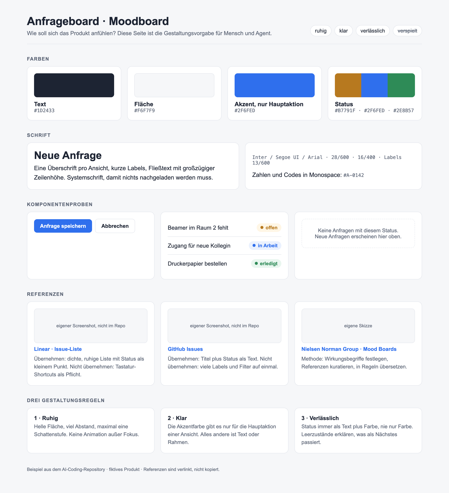
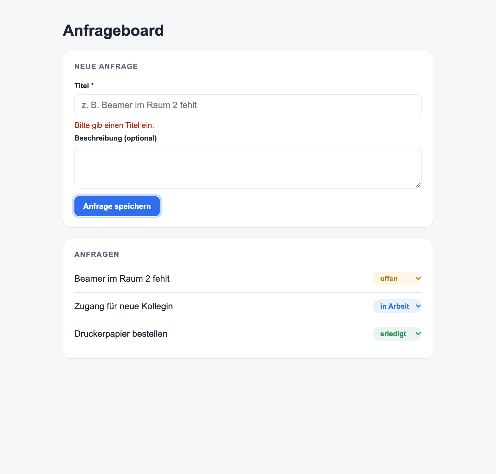

<p align="left"><a href="https://sebmer.com"></a></p>

# AI-Coding

**Beispieldateien, Vorlagen und Anleitungen, um mit Coding-Agenten (Claude Code, Codex) kontrolliert und testgetrieben Software zu bauen.**

[English](README.md) · [Lizenz: Apache-2.0](LICENSE)

Dieses Repository begleitet ein Arbeitsheft zum AI Coding. Jede Einheit des Hefts endet mit einer Datei im eigenen Repository. Hier siehst du, **wie diese Dateien aussehen**, am Beispiel eines fiktiven Produkts, dem *Anfrageboard*, und findest leere Vorlagen zum Kopieren.

<p>


</p>

## Inhalt

| Ordner | Inhalt |
|---|---|
| [`examples/de/`](examples/de/) | Vollständiges Beispielprojekt auf Deutsch: Dokumente **und** eine lauffähige Vite-+-React-App mit Vitest- und Playwright-Tests |
| [`examples/en/`](examples/en/) | Dasselbe Beispiel auf Englisch (*Request board*) |
| [`templates/de/`](templates/de/), [`templates/en/`](templates/en/) | Leere Vorlagen für dein eigenes Repository |
| [`guides/de/`](guides/de/), [`guides/en/`](guides/en/) | Kurzanleitungen: Agent einrichten, Superpowers, Browser-Agenten, Supabase, Vercel, Docker, WSL |
| [`assets/screenshots/`](assets/screenshots/) | Screenshots aus dem Arbeitsheft |

## Der Dateipfad durch den Kurs

| Einheit | Datei | Beispiel |
|---|---|---|
| Kurs 0 · Startklar | `docs/00-setup.md` | [Beispiel](examples/de/docs/00-setup.md) |
| SLE 1 · Use Case | `docs/idee.md` | [Beispiel](examples/de/docs/idee.md) |
| SLE 2 · Produkt | `docs/onepager.md`, `docs/moodboard.html`, `docs/wireframes/`, `docs/architektur.md` | [One-Pager](examples/de/docs/onepager.md) · [Moodboard](examples/de/docs/moodboard.html) · [Wireframes](examples/de/docs/wireframes/) · [Architektur](examples/de/docs/architektur.md) |
| SLE 3 · Kontext | `PLAN.md`, `docs/prd/`, `AGENTS.md`, `CLAUDE.md`, Tests | [Plan](examples/de/PLAN.md) · [PRDs](examples/de/docs/prd/) · [AGENTS.md](examples/de/AGENTS.md) |
| SLE 3 · Superpowers | `docs/superpowers/specs/`, `docs/superpowers/plans/` | [Spec](examples/de/docs/superpowers/specs/) · [Plan](examples/de/docs/superpowers/plans/) |
| SLE 4 · MVP | `src/`, `tests/` | [App](examples/de/src/) · [Tests](examples/de/tests/) |
| SLE 5–6 · Nachweise | `EVIDENCE.md` | [Beispiel](examples/de/EVIDENCE.md) |
| alle Einheiten | Prompts | [Prompt-Sammlung](examples/de/prompts.md) |

## Beispiel-App starten

```bash
cd examples/de          # oder examples/en
npm install
npm run dev             # http://localhost:5173
npm test                # 7 Unit-Tests (Vitest)
npx playwright install chromium
npm run test:e2e        # 4 Browser-Tests (Playwright)
```

Die App speichert nur im eigenen Browser (`localStorage`). Kein Konto, kein Server, keine Secrets.

## So nutzt du das Repository

1. Kopiere die Dateien aus `templates/de/` in dein Repository.
2. Öffne das passende Beispiel daneben.
3. Lass deinen Agenten die Vorlage füllen und prüfe den Diff selbst.

## Prinzipien

- **Kontext vor Code.** One-Pager, Moodboard, Architektur und PRDs stehen, bevor der Agent Features baut.
- **Test zuerst.** Jedes Akzeptanzkriterium wird ein Test, der erst fehlschlägt und dann grün wird.
- **Kleine Loops.** Ein Paket pro Loop, ein Commit pro Paket, Stopp nach zwei Fehlversuchen.
- **Nachweise.** Was funktioniert, zeigt ein Test, keine Behauptung.

## Lizenz

Code und Texte: [Apache License 2.0](LICENSE). Die Seb-Builds-Wortmarke fällt nicht unter die Lizenz, siehe [NOTICE](NOTICE). Alle Beispieldaten sind fiktiv; fremde Produkte sind verlinkt, nicht kopiert.
