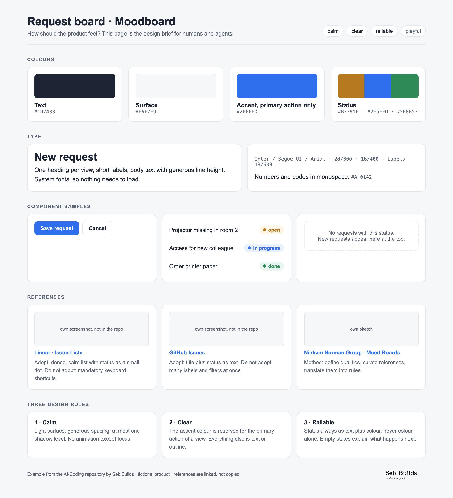
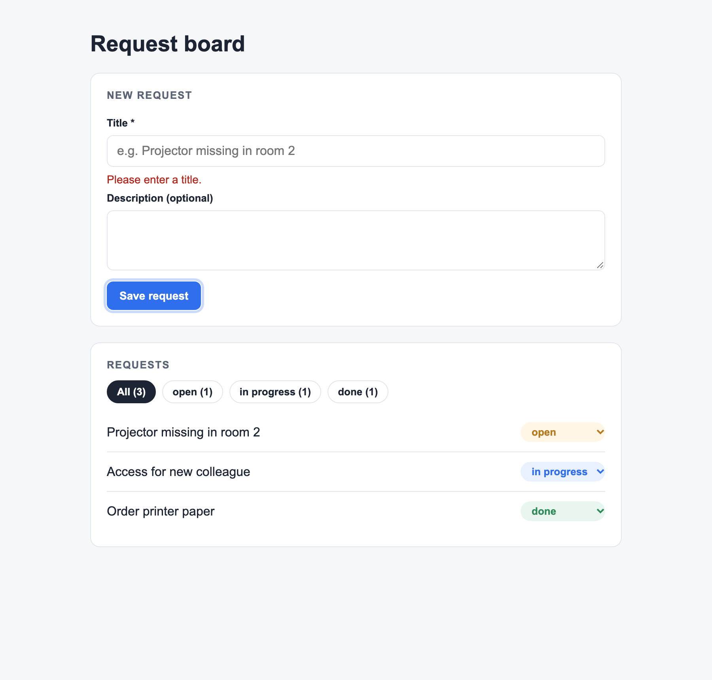

<p align="left"><a href="https://sebmer.com"></a></p>

# AI-Coding

**Example files, templates and guides for building software with coding agents (Claude Code, Codex) in a controlled, test-first way.**

[Deutsch](README.de.md) · [License: Apache-2.0](LICENSE)

This repository accompanies an AI coding workbook. Every unit of the workbook ends with a file in your own repository. Here you find **what those files look like** for a fictional product, the *Request board*, plus empty templates to copy.

<p>


</p>

## What is inside

| Folder | Content |
|---|---|
| [`examples/en/`](examples/en/) | Complete example project in English: documents **and** a runnable Vite + React app with Vitest and Playwright tests |
| [`examples/de/`](examples/de/) | The same example in German (*Anfrageboard*) |
| [`templates/en/`](templates/en/), [`templates/de/`](templates/de/) | Empty templates to copy into your own repository |
| [`guides/en/`](guides/en/), [`guides/de/`](guides/de/) | Short guides: agent setup, Superpowers, browser agents, Supabase, Vercel, Docker, WSL |
| [`assets/screenshots/`](assets/screenshots/) | Screenshots used in the workbook |

## The file path through the course

| Unit | File | Example |
|---|---|---|
| Course 0 · Setup | `docs/00-setup.md` | [example](examples/en/docs/00-setup.md) |
| Unit 1 · Use case | `docs/idea.md` | [example](examples/en/docs/idea.md) |
| Unit 2 · Product | `docs/one-pager.md`, `docs/moodboard.html`, `docs/wireframes/`, `docs/architecture.md` | [one-pager](examples/en/docs/one-pager.md) · [moodboard](examples/en/docs/moodboard.html) · [wireframes](examples/en/docs/wireframes/) · [architecture](examples/en/docs/architecture.md) ([Mermaid source](examples/en/docs/architecture.mmd)) |
| Unit 3 · Context | `PLAN.md`, `docs/prd/`, `AGENTS.md`, `CLAUDE.md`, tests | [plan](examples/en/PLAN.md) · [PRDs](examples/en/docs/prd/) · [AGENTS.md](examples/en/AGENTS.md) |
| Unit 3 · Superpowers | `docs/superpowers/specs/`, `docs/superpowers/plans/` | [spec](examples/en/docs/superpowers/specs/) · [plan](examples/en/docs/superpowers/plans/) · [status and gates](examples/en/PLAN.md#status-and-gates) |
| Unit 3 · Diagrams | `docs/mermaider/` (generated by [Mermaider](https://github.com/sebmer-com/mermaider)) | [diagrams](docs/mermaider/) |
| Unit 4 · MVP | `src/`, `tests/` | [app](examples/en/src/) · [tests](examples/en/tests/) |
| Units 5–6 · Evidence | `EVIDENCE.md` | [example](examples/en/EVIDENCE.md) |
| All units | prompts | [prompt collection](examples/en/prompts.md) |

## Run the example app

```bash
cd examples/en          # or examples/de
npm install
npm run dev             # http://localhost:5173
npm test                # 11 unit tests (Vitest)
npx playwright install chromium
npm run test:e2e        # 7 browser tests (Playwright)
```

The app stores data in your browser only (`localStorage`). No account, no server, no secrets.

## Use it in your own project

1. Copy the files from `templates/en/` into your repository.
2. Open the matching example next to it.
3. Let your agent fill the template, then review the diff yourself.

## Principles

- **Context before code.** One-pager, moodboard, architecture and PRDs exist before the agent writes features.
- **Test first.** Each acceptance criterion becomes a test that fails before it passes.
- **Small loops.** One package per loop, one commit per package, stop after two failed attempts.
- **Evidence.** What works is shown by a test, not by a claim.

## License

Code and text: [Apache License 2.0](LICENSE). The Seb Builds wordmark is not covered by the license, see [NOTICE](NOTICE). All example data is fictional; third-party products are linked, not copied.
