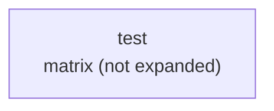

# examples — declared CI jobs

Generated by Mermaider. View: **implemented**. Basis: **declared source structure**.

## Sources

- [.github/workflows/examples.yml:13](../../.github/workflows/examples.yml#L13)

Freshness checks confirm the recorded source evidence and generated output. They do not establish live deployment or prove every semantic interpretation.
