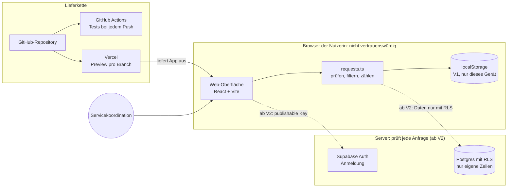

# Architektur: Anfrageboard

Version 1 läuft komplett im Browser. Version 2 ergänzt Anmeldung und Datenbank. Die Diagrammquelle liegt versionierbar in [`architektur.mmd`](architektur.mmd); dieser Block zeigt denselben Text, damit GitHub ihn als Grafik darstellt.

## Komponenten und Datenfluss

| Komponente | Aufgabe | Daten | Vertrauen |
|---|---|---|---|
| Web-Oberfläche | Formular, Liste, Filter | zeigt Anfragen an | läuft beim Nutzer, alles darin ist manipulierbar |
| `requests.ts` | Titel prüfen, Status normalisieren, filtern, zählen | Anfrage-Objekte | gleiche Prüfung muss ab V2 auch der Server leisten |
| `localStorage` (V1) | speichert die Liste im Browser | nur dieses Gerät | keine Anmeldung, keine Weitergabe |
| Supabase Auth und Postgres (V2) | Anmeldung, gemeinsame Daten | Anfragen mit `owner` | Row Level Security entscheidet, welche Zeilen jemand sieht |
| GitHub Actions | Unit- und Browser-Tests bei jedem Push | Code, keine Secrets | Ergebnis ist Nachweis in `EVIDENCE.md` |
| Vercel | baut Preview und Produktion | Umgebungsvariablen im Dashboard | `VITE_`-Variablen sind öffentlich |

## Vertrauensgrenzen

1. **Browser → Server (ab V2):** Alles, was aus dem Browser kommt, gilt als ungeprüft. Rechte prüft die Datenbank mit RLS, nie nur die Oberfläche.
2. **Repository → Hosting:** Secrets liegen nur im Vercel-Dashboard bzw. in `.env`, nie im Repository.
3. **Agent → Repository:** Der Agent ändert Code nur im Projektordner und nach den Regeln in `AGENTS.md`; Rechte regelt die Rechtestufe, nicht diese Datei.

## Entscheidungen

| Entscheidung | Begründung | Alternative |
|---|---|---|
| Vite + React + TypeScript | schneller Start, Agenten kennen den Stack gut | Next.js (mehr Server-Funktionen, mehr Komplexität) |
| V1 ohne Server | kein Secret, kein Hosting nötig, schnell testbar | sofort Supabase |
| Tests mit Vitest und Playwright | Logik und Klickpfade getrennt prüfbar | nur manuelle Tests |

## Offen

- Wo laufen Preview und Produktion? (Vorschlag: Vercel Hobby für das Lab, Pro für echten Betrieb)
- Wer darf Anfragen löschen?
