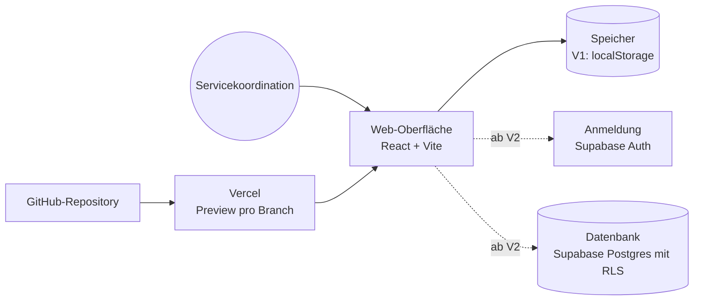

# Architektur: Anfrageboard

Version 1 läuft komplett im Browser. Version 2 ergänzt Anmeldung und Datenbank.

## Entscheidungen

| Entscheidung | Begründung | Alternative |
|---|---|---|
| Vite + React + TypeScript | schneller Start, Agenten kennen den Stack gut | Next.js (mehr Server-Funktionen, mehr Komplexität) |
| V1 ohne Server | kein Secret, kein Hosting nötig, schnell testbar | sofort Supabase |
| Tests mit Vitest und Playwright | Logik und Klickpfade getrennt prüfbar | nur manuelle Tests |

## Offen

- Wo laufen Preview und Produktion? (Vorschlag: Vercel Hobby für das Lab, Pro für echten Betrieb)
- Wer darf Anfragen löschen?
