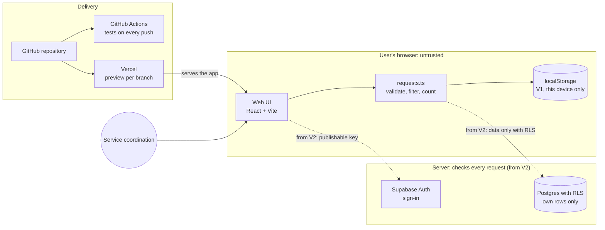

# Architecture: Request board

Version 1 runs entirely in the browser. Version 2 adds sign-in and a database. The diagram source is versioned in [`architecture.mmd`](architecture.mmd); this block shows the same text so GitHub renders it.

## Components and data flow

| Component | Job | Data | Trust |
|---|---|---|---|
| Web UI | form, list, filter | shows requests | runs on the user's device, everything in it can be tampered with |
| `requests.ts` | validate title, normalise status, filter, count | request objects | from V2 the server must enforce the same checks |
| `localStorage` (V1) | stores the list in the browser | this device only | no sign-in, nothing shared |
| Supabase Auth and Postgres (V2) | sign-in, shared data | requests with `owner` | Row Level Security decides which rows someone sees |
| GitHub Actions | unit and browser tests on every push | code, no secrets | the result is evidence in `EVIDENCE.md` |
| Vercel | builds preview and production | environment variables in the dashboard | `VITE_` variables are public |

## Trust boundaries

1. **Browser → server (from V2):** Everything coming from the browser is unverified. The database checks permissions with RLS, never only the UI.
2. **Repository → hosting:** Secrets live only in the Vercel dashboard or in `.env`, never in the repository.
3. **Agent → repository:** The agent changes code only inside the project folder and follows `AGENTS.md`; permissions come from the permission mode, not from that file.

## Decisions

| Decision | Reason | Alternative |
|---|---|---|
| Vite + React + TypeScript | quick start, agents know the stack well | Next.js (more server features, more complexity) |
| V1 without a server | no secret, no hosting, easy to test | Supabase right away |
| Tests with Vitest and Playwright | logic and click paths tested separately | manual tests only |

## Open

- Where do preview and production run? (Suggestion: Vercel Hobby for the lab, Pro for real operation)
- Who may delete requests?
