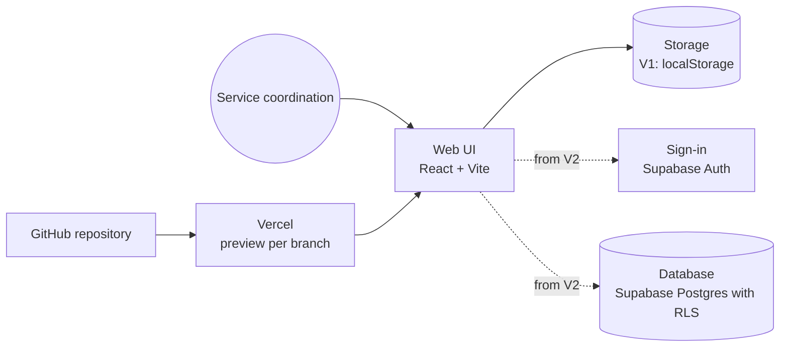

# Architecture: Request board

Version 1 runs entirely in the browser. Version 2 adds sign-in and a database.

## Decisions

| Decision | Reason | Alternative |
|---|---|---|
| Vite + React + TypeScript | fast start, agents know the stack well | Next.js (more server features, more complexity) |
| V1 without a server | no secrets, no hosting needed, quick to test | Supabase from day one |
| Tests with Vitest and Playwright | logic and click paths tested separately | manual testing only |

## Open

- Where do preview and production run? (Proposal: Vercel Hobby for the lab, Pro for real use)
- Who may delete requests?
